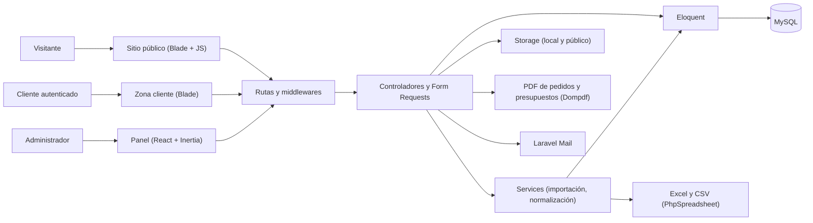
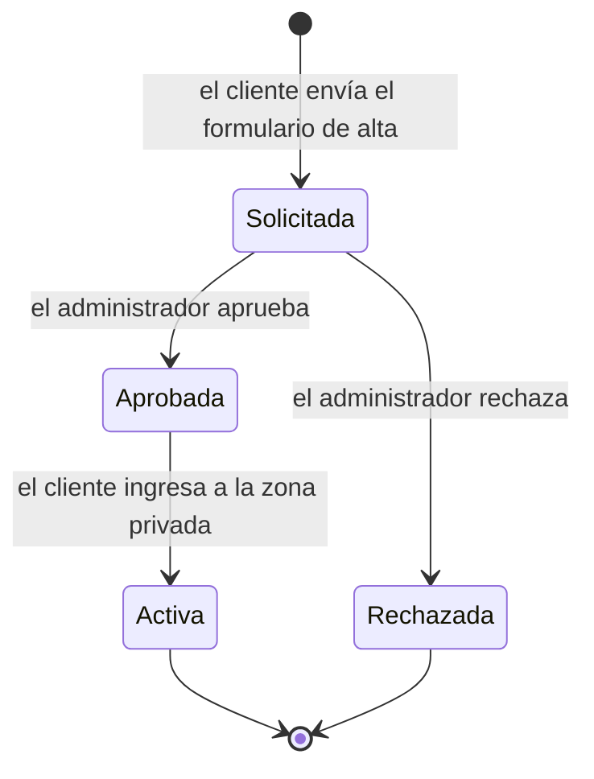
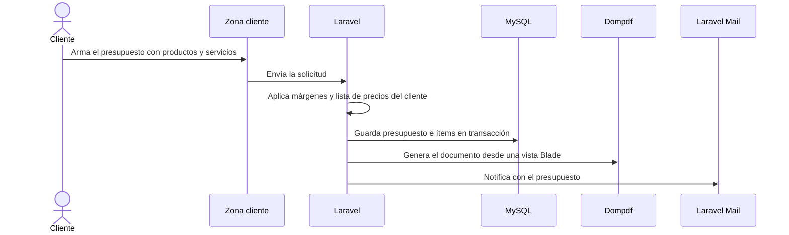
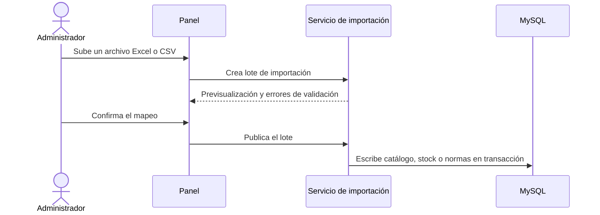
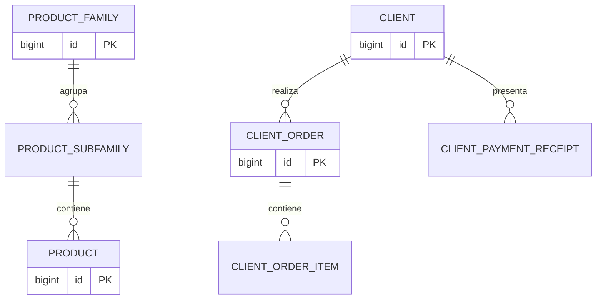

<div align="center">

<br/>

**Sitio corporativo con catálogo técnico de materiales, zona privada de clientes y panel de contenido.**


</div>


## 📑 Contenido

[El problema](#-el-problema) · [La solución](#-la-solución) · [Funcionalidades](#-funcionalidades) · [Arquitectura](#-arquitectura) · [Flujos de trabajo](#-flujos-de-trabajo) · [Modelo de datos](#-modelo-de-datos) · [Criterios y decisiones](#-criterios-y-decisiones) · [Stack](#-stack) · [Estructura](#-estructura-del-repo) · [Puesta en marcha](#-puesta-en-marcha) · [Pruebas y calidad](#-pruebas-y-calidad) · [Despliegue](#-despliegue) · [Estado y pendientes](#-estado-y-pendientes) · [Licencia y autoría](#-licencia-y-autoría)


## 🧩 El problema

La empresa maneja un catálogo técnico amplio: familias, líneas, series, grados, formas, normas y composición química. Esa información vivía dispersa en planillas y documentos, y las consultas de clientes (precios, stock, presupuestos, pagos) llegaban por canales separados. Calcular el peso de una pieza y verificar una norma eran pasos manuales.

## 💡 La solución

**Nicolais Mario e Hijo** es una aplicación Laravel con tres perfiles:

- **Visitantes**: sitio institucional, catálogo público jerárquico, buscador, calculadora de peso y consulta de ofertas y novedades.
- **Clientes**: zona privada con acceso sujeto a aprobación, catálogo privado, carrito, pedidos, presupuestos, servicios adicionales, listas de precios y comprobantes de pago.
- **Administración**: panel para contenidos, catálogo, importaciones desde Excel y CSV, usuarios, medios, SEO y campañas de newsletter.


## ✨ Funcionalidades

**Sitio público** (rol: visitante)
- Catálogo por familias, líneas, series, grados, formas, variantes, normas y composición química.
- Buscador y sugerencias sobre productos y referencias técnicas.
- Calculadora de peso configurable por materiales, formas, campos y fórmulas.
- Formularios de contacto, presupuesto, alta de clientes y newsletter, con notificaciones por correo.

**Zona cliente** (rol: cliente aprobado)
- Catálogo privado, carrito, pedidos y presupuestos en PDF.
- Servicios adicionales y márgenes; listas de precios asignadas por cliente.
- Carga y revisión de comprobantes de pago.

**Panel administrativo** (rol: administrador)
- Importación, previsualización, validación, mapeo, publicación y exportación de catálogos, stock y normas en Excel y CSV.
- Productos comerciales, imágenes, fichas técnicas, especificaciones y relacionados.
- Campañas de newsletter, metadatos SEO, sitemap, robots.txt y web manifest.
- Registro de actividad autenticada, sesiones de visita y eventos de seguridad.


## 🏗️ Arquitectura

Monolito modular con Laravel y Eloquent. Las rutas públicas y de cliente se renderizan con Blade y JavaScript progresivo; el panel usa React con Inertia, sin una API pública separada. La lógica de importación y normalización vive en `app/Services`; controladores, Form Requests y middlewares coordinan HTTP, validación y seguridad.






## 🔄 Flujos de trabajo

**Acceso de un cliente a la zona privada**



**Presupuesto con PDF**



**Importación de catálogo**




## 🗃️ Modelo de datos

Eloquent con 65 migraciones y 48 modelos en el repositorio. Cuatro áreas principales:

- **Catálogo técnico y comercial:** familias y subfamilias, productos, medios, tablas de especificaciones y relacionados, y la calculadora de peso.
- **Operación de clientes:** `ClientAccessRequest`, `Client`, `ClientOrder` e ítems, `QuoteRequest` con adjuntos, `ClientPriceListFile`, `ClientPaymentReceipt`.
- **Contenido y operación web:** secciones, noticias (`Post`), medios, SEO, formularios de contacto, newsletter, visitas y `SecurityEvent`.
- **Configuración del sitio:** contacto, pie de página, portada y datos de presupuesto editables.



El catálogo técnico (grados, normas, formas) y la calculadora de peso tienen sus propias tablas y modelos (`WeightCalculator*`). Las relaciones incluyen jerarquías uno a muchos y asociaciones muchos a muchos entre grados y normas, ofertas y productos, y listas de precios y clientes. Los flujos de publicación, importación, pedidos, presupuestos y limpieza de catálogo usan transacciones.


## 🧭 Criterios y decisiones

- **Acceso por aprobación.** La zona cliente no se abre sin una solicitud aprobada, asociada a su usuario.
- **Importación en pasos.** Previsualizar, validar, mapear y publicar evita cargar un archivo malo al catálogo.
- **Documentos en el servidor.** Pedidos y presupuestos se generan como PDF desde Blade, sin depender de un servicio externo.
- **Límites en formularios públicos.** Honeypot, tiempo mínimo de envío y límites por ruta, correo e IP.

| Decisión | Por qué |
| --- | --- |
| Monolito Laravel con Blade y React/Inertia | Una sola base y un solo despliegue; el sitio público necesita render en servidor y el panel necesita interacción. |
| Sin API pública versionada | El repositorio solo expone endpoints JSON internos del panel. |
| Storage con UUID en los nombres de archivo | Evita colisiones y no expone los nombres originales. |


## 🧱 Stack

| Capa | Tecnología | Versión |
| --- | --- | --- |
| Lenguaje | PHP | ^8.3 |
| Backend | Laravel framework | ^13 (lock 13.31.0) |
| Integración panel | inertiajs/inertia-laravel | 3.3.4 |
| API y sesiones | Laravel Sanctum | 4.3.3 |
| Frontend | React | 19.2.6 |
| Frontend | @inertiajs/react | 3.1.1 |
| Estilos | Tailwind CSS | 4.3.0 |
| Build | Vite | 8.3.0 |
| Documentos | Dompdf | según `composer.json` |
| Hojas de cálculo | PhpSpreadsheet | según `composer.json` |
| Base de datos | MySQL | configurada en `.env.example` |


## 🗂️ Estructura del repo

```text
app/Http/Controllers/    sitio, zona cliente, panel y endpoints JSON internos
app/Http/Requests/       validación de formularios
app/Services/            importación y normalización de catálogo
app/Models/              entidades Eloquent (48)
database/migrations/     esquema relacional (65)
resources/views/         Blade público, zona cliente y PDF
resources/js/            panel React e Inertia
routes/web.php           rutas públicas, cliente y panel
routes/auth.php          autenticación
routes/console.php       comandos programados
tests/                   pruebas Feature
docs/readme/             recursos visuales del README
```


## 🚀 Puesta en marcha

Requisitos: PHP 8.3+, Composer, Node.js, npm y MySQL.

```bash
composer install
npm ci
cp .env.example .env              # definir base, correo y almacenamiento localmente
php artisan key:generate
php artisan migrate
php artisan storage:link
composer dev                      # servidor, cola, logs y Vite en paralelo
```

Variables relevantes (por nombre): `DB_*`, `MAIL_*`, `QUEUE_CONNECTION`, `FILESYSTEM_*`, y la configuración de correo y HMAC de seguridad. Los valores reales no se versionan.


## 🧪 Pruebas y calidad

Pruebas Feature sobre catálogo, normas, stock, búsqueda, SEO, infraestructura, productos destacados y zona cliente. La suite usa SQLite, caché y sesión en memoria, correo simulado y colas síncronas.

```bash
composer test
npm run build
./vendor/bin/pint --test
npm audit
composer audit
```

La última verificación registrada en el README anterior fue de 85 pruebas y 446 aserciones aprobadas, con `php artisan test --compact`; no se volvió a ejecutar para este cambio. El propio README anterior indica que la suite requiere estabilización. No hay pipeline CI versionado.


## 🚢 Despliegue

Documentado como despliegue Laravel: Composer, build de Vite, migraciones, enlace de storage y cachés, con `composer dev` para desarrollo. No hay infraestructura como código ni pipeline CI/CD. El servidor web, proveedor, backups y proceso de publicación quedan fuera del repositorio.


## 📌 Estado y pendientes

- **Estado:** aplicación funcional con catálogo, zona cliente, importaciones, PDF y panel. Producción no verificada.
- **Último commit:** 2026-07-12, `VERSION 1.1.2`, en el historial local.
- **Pendientes:**
  - Estabilizar la suite de pruebas y volver a registrar su resultado.
  - Definir el despliegue, las copias de seguridad y el proceso de publicación.
  - Repetir periódicamente `npm audit` y `composer audit`.


## 📄 Licencia y autoría

Desarrollado por el **Ing. Santiago Abasto**.


Repositorio sin archivo de licencia. El código y el contenido son propiedad del cliente, Nicolais Mario e Hijo, salvo que se acuerde otra cosa.
